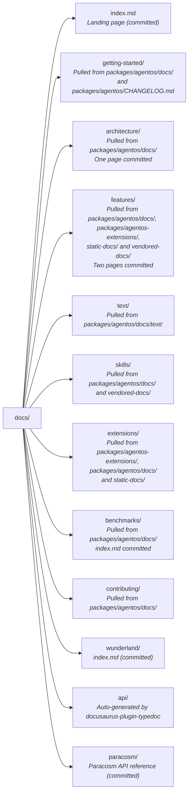

<div align="center">

<p align="center">
  <a href="https://agentos.sh/en"></a>
  &nbsp;&nbsp;&nbsp;
  <a href="https://frame.dev" target="_blank" rel="noopener"></a>
</p>

# AgentOS Documentation

Unified documentation site for AgentOS — guides, architecture, extensions, and API reference.

[Frame.dev](https://frame.dev) • [AgentOS](https://agentos.sh/en) • [Docs](https://docs.agentos.sh)

</div>

---

Built with [Docusaurus v3](https://docusaurus.io/) and [docusaurus-plugin-typedoc](https://github.com/typedoc2md/docusaurus-plugin-typedoc).

## Development

```bash
npm install
npm start        # Dev server at localhost:3000
npm run start:guides  # Faster local mode: guides/docs only, skips API, Paracosm, and blog builds
```

## Build

```bash
npm run build    # Runs pull-docs + docusaurus build
npm run build:guides  # Faster local build for guides/docs only
npm run test:publication  # Contract, link, search manifest, star badge, landing count and workflow tests
npm run test:built        # Checks the built pages; run it after a build
npm run verify:publication # Strict publication check, full production build, then the built-page check
npm run serve    # Preview production build
```

The `prebuild` step runs `scripts/pull-docs.mjs`, which copies every page the publication manifest lists into the `docs/` tree, adds Docusaurus front matter and rewrites links. The pages come from `packages/agentos/`, `packages/agentos-extensions/`, `static-docs/` and `vendored-docs/`; [CONTRIBUTING.md](https://github.com/framerslab/agentos-live-docs/blob/master/CONTRIBUTING.md#where-a-page-comes-from) says which page comes from where.

### Fast Local Guides Mode

`npm run build:guides` and `npm run start:guides` are for local docs iteration when you do **not** need the generated API/Paracosm reference surfaces or the blog.

- Disables Typedoc generation for `docs/api` and `docs/paracosm`
- Excludes `api/**` and `paracosm/**` from the docs preset
- Disables the blog surface entirely
- Disables local search indexing and the marketing-site search-manifest plugin
- Hides API/Paracosm/blog navbar, sidebar, and footer entry points in this mode

Most pages of the full build are the API and Paracosm reference pages that TypeDoc writes, and the guides mode skips them. A full build prints their count on its `[inject-noindex]` line.

Use `npm run verify:publication` before shipping changes. That path keeps strict broken-link handling enabled and builds the full published site.

## Structure



Git ignores everything inside the folders under `docs/` except the committed files, which `.gitignore` lists as exceptions, so the pages a local build pulls never show up as changes. A build with the Paracosm source beside this repository (`../paracosm/`) rewrites the committed `docs/paracosm/`; leave those changes out of a commit.

## Deployment

Deployed via GitHub Actions on every push to `master`, daily at 07:23 UTC and on a manual run on `master`. The workflow checks out this repository at `apps/agentos-live-docs/`, and the `agentos` and `agentos-extensions` repos at `packages/agentos/` and `packages/agentos-extensions/`, the layout the build's relative paths expect, then builds, checks the built pages (`npm run test:built`) and deploys to GitHub Pages. A failed check stops the deploy. A re-run builds and checks the site and does not deploy; to deploy again, start the workflow on `master`.

## Contributing and support

| Guide | What |
|---|---|
| [Contributing](https://github.com/framerslab/agentos-live-docs/blob/master/CONTRIBUTING.md) | Where each page's source lives, development setup, pull request rules, review threads, contribution licensing |
| [Agent instructions](https://github.com/framerslab/agentos-live-docs/blob/master/AGENTS.md) | Commands and conventions for coding agents |
| [Code of Conduct](https://github.com/framerslab/agentos-live-docs/blob/master/.github/CODE_OF_CONDUCT.md) | Community standards |
| [Security Policy](https://github.com/framerslab/agentos-live-docs/blob/master/.github/SECURITY.md) | Reporting vulnerabilities privately |
| [Support](https://github.com/framerslab/agentos-live-docs/blob/master/SUPPORT.md) | Where to get help |

## License

MIT

---

<p align="center">
  <a href="https://agentos.sh/en"></a>
  &nbsp;&nbsp;&nbsp;
  <a href="https://frame.dev"></a>
</p>

<p align="center">
  Built by <a href="https://frame.dev">Frame</a><br>
  Contact: <a href="mailto:team@frame.dev">team@frame.dev</a>
</p>
